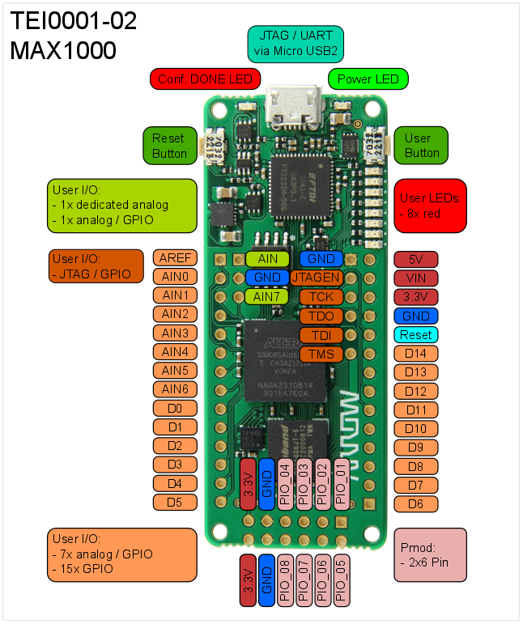
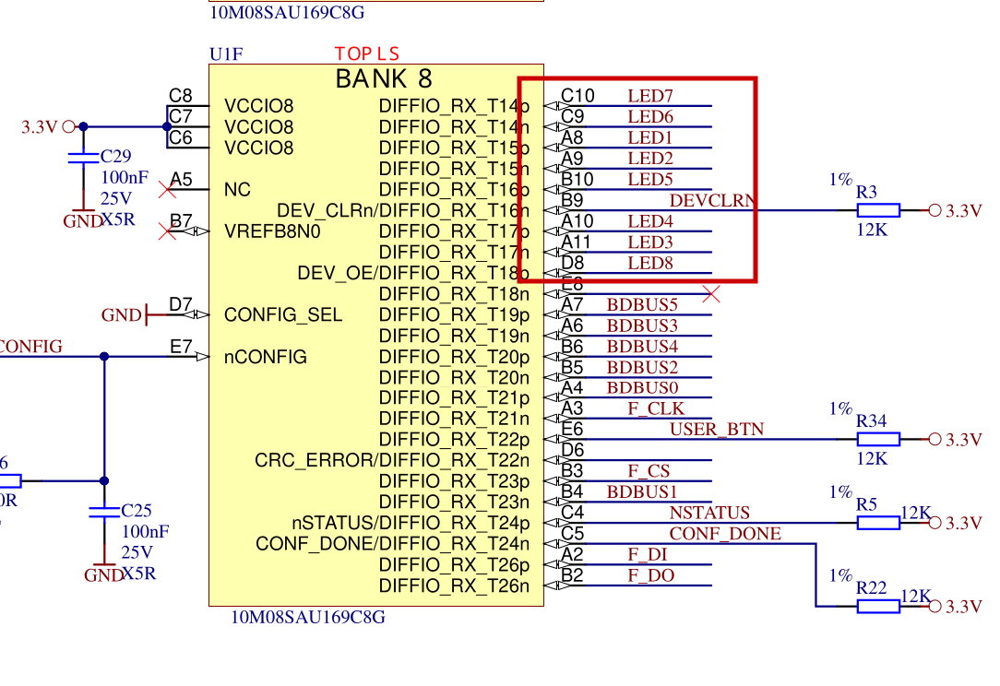
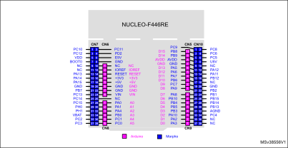
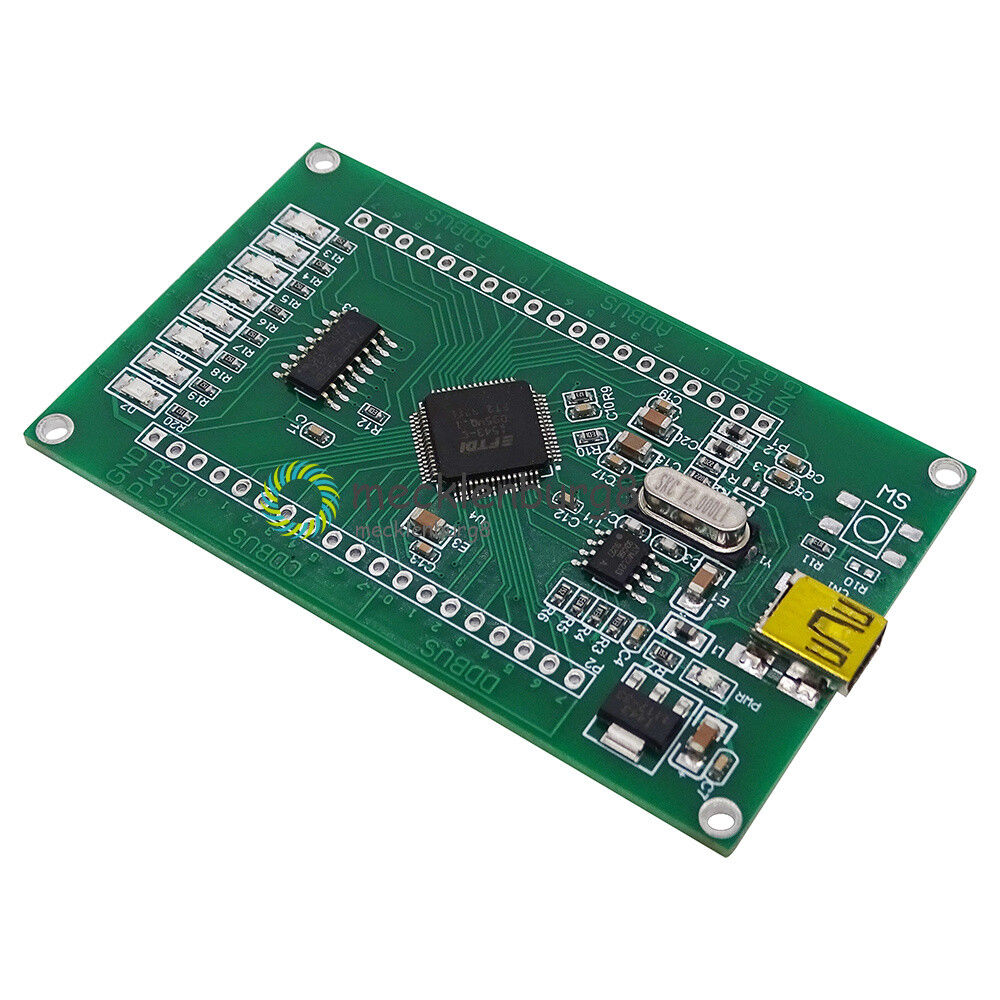
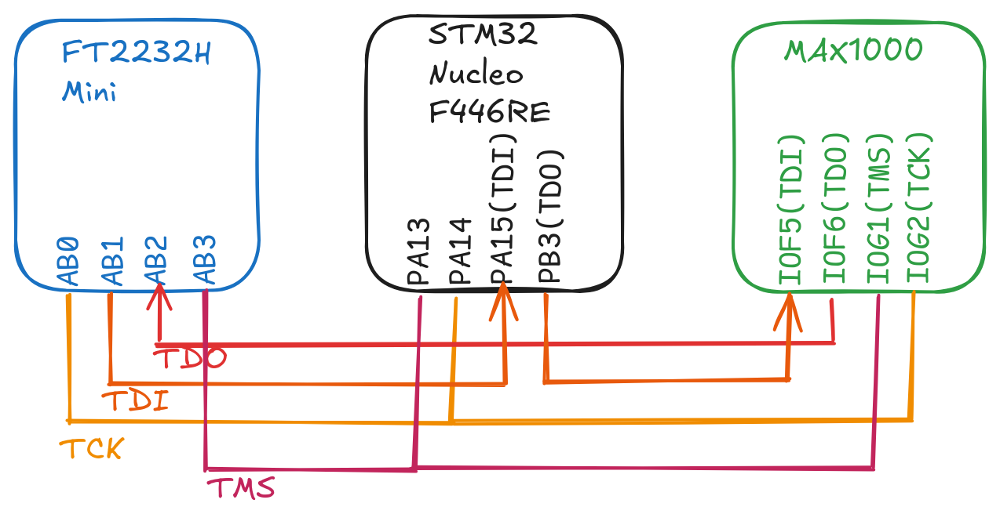
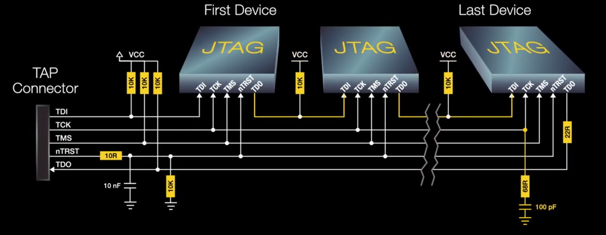

# learn-boundary-scan
JTAG and Boundary Scan Basics with low price Hardware 

## Things you need  
  
  
  
  
[on ebay](https://www.ebay.de/itm/265993756736?_skw=ft2232&itmmeta=01M6PQ0XWMB1DCS2C043ZNTX8C&hash=item3dee76a040:g:ddoAAOSwdHRjdZys&itmprp=enc%3AAQALAAAA8CHNgUiiE%2FjQhlDTaMiAde8UnivYtuuf1oo0AGURx0LGN%2BPUHMYM9LpCCYqT6sVC05qNus3w0SfR1J8Er3rfPLJST7wkwdx6DOlTNgtWLjMvifUuh0On9n5vwOR23Zt8S6CO0odvclKxGXhHJHVkZoldgRPFiufyJ2ofRDoujkWGcWqq6xkG1juugf0%2FNQJV0Iur%2BqGlS0hpLTzJIhLRS0I3sA9SLwMuzMCWJ5hKvit0hYqj%2BIHlDJyXTNiVfRq4RGt3ByYGAxM8cHjvVQ1IV9iG48PRqaTp3DxWS1lc52nH%2BsR%2F2GMNtrwdQJjcl51qvw%3D%3D%7Ctkp%3ABk9SR6bfg9e1aA)  

Some bread board wires. Pullups would be nice but it works without them too.  

## Setup  
  
  
[XJTAG](https://www.youtube.com/watch?v=PgUmq32-HO4)  

## cableing the FT2232H board  
JTAG pin mapping (channel A, MPSSE default)

| JTAG signal | FT2232H pin |
| --- | --- |
| TCK	| ADBUS0 |
| TDI	| ADBUS1 |
| TDO	| ADBUS2 |
| TMS	| ADBUS3 |
| GND	| any GND pin |


## Software  

UrJTAG CLI based Software  
openOCD CLI based Software  

```
sudo apt install openwince-jtag  
sudo apt install urjtag  
sudo apt install openocd  
```

## UrJTAG
```
lmwb@macbookpro12:~/work/git/LMWB$ jtag -v

UrJTAG 2021.03 #

Copyright (C) 2002, 2003 ETC s.r.o.
Copyright (C) 2007, 2008, 2009 Kolja Waschk and the respective authors

This program is free software; you can redistribute it and/or modify
it under the terms of the GNU General Public License as published by
the Free Software Foundation; either version 2 of the License, or
(at your option) any later version.

This program is distributed in the hope that it will be useful,
but WITHOUT ANY WARRANTY; without even the implied warranty of
MERCHANTABILITY or FITNESS FOR A PARTICULAR PURPOSE.  See the
GNU General Public License for more details.

You should have received a copy of the GNU General Public License
along with this program; if not, write to the Free Software
Foundation, Inc., 59 Temple Place, Suite 330, Boston, MA  02111-1307  USA
```

### first test  
```
cable ft2232 vid=0x0403 pid=0x6010 interface=0
detect
print chain
```

### minimal workflow  
```
cable ft2232 vid=0x0403 pid=0x6010 #cable <your adapter>   # depends on FTDI pinout, e.g. jtagkey

bsdl path /path/to/bsdl_folder
detect
part 0                 # the boundary-scan TAP
instruction SAMPLE/PRELOAD
shift ir
shift dr
set signal PA5 out 1
instruction EXTEST
shift ir
shift dr               # LED turns on
set signal PA5 out 0
shift dr               # LED turns off
```

### Select a part and read it's IDCODE directly  
```
part 0
instruction IDCODE
shift ir
shift dr
dr
```

### scripting  

Put these lines into a textfile called led.jtag.  

```
cable ft2232 vid=0x0403 pid=0x6010 interface=0
bsdl path /path/to/bsdl_folder
detect
part 0
instruction SAMPLE/PRELOAD
shift ir
shift dr
set signal PA5 out 1
instruction EXTEST
shift ir
shift dr
instruction BYPASS
shift ir
reset
```

Then run it with jtag led.jtag, or from inside UrJTAG with script led.jtag. 

Include led.urjtag. 

Put a usleep between steps if you want the LED to stay on visibly before the release.

## openOCD  
[openOCD test](./openOCD/openocd_chain_config.md)  

Flashing a 250 kBytes file with 1MHz and three members in the chain takes aprox 6 sec.  

```tcl
lmwb@macbookpro12:~/work/git/LMWB/learn-boundary-scan$ /bin/python3 /home/lmwb/work/git/LMWB/learn-boundary-scan/python/flash_bin_openOCD.py
Open On-Chip Debugger 0.12.0
Licensed under GNU GPL v2
For bug reports, read
        http://openocd.org/doc/doxygen/bugs.html
none separate

Info : clock speed 1000 kHz
Info : JTAG tap: max10.tap tap/device found: 0x031820dd (mfg: 0x06e (Altera), part: 0x3182, ver: 0x0)
Info : JTAG tap: stm32f4x.cpu tap/device found: 0x4ba00477 (mfg: 0x23b (ARM Ltd), part: 0xba00, ver: 0x4)
Info : JTAG tap: stm32f4x.bs tap/device found: 0x06421041 (mfg: 0x020 (STMicroelectronics), part: 0x6421, ver: 0x0)
Info : [stm32f4x.cpu] Cortex-M4 r0p1 processor detected
Info : [stm32f4x.cpu] target has 6 breakpoints, 4 watchpoints
Info : starting gdb server for stm32f4x.cpu on 3333
Info : Listening on port 3333 for gdb connections
Info : JTAG tap: max10.tap tap/device found: 0x031820dd (mfg: 0x06e (Altera), part: 0x3182, ver: 0x0)
Info : JTAG tap: stm32f4x.cpu tap/device found: 0x4ba00477 (mfg: 0x23b (ARM Ltd), part: 0xba00, ver: 0x4)
Info : JTAG tap: stm32f4x.bs tap/device found: 0x06421041 (mfg: 0x020 (STMicroelectronics), part: 0x6421, ver: 0x0)
[stm32f4x.cpu] halted due to debug-request, current mode: Thread 
xPSR: 0x01000000 pc: 0x08000914 msp: 0x20020000
** Programming Started **
Info : device id = 0x10006421
Info : flash size = 512 KiB
** Programming Finished **
** Verify Started **
** Verified OK **
** Resetting Target **
Info : JTAG tap: max10.tap tap/device found: 0x031820dd (mfg: 0x06e (Altera), part: 0x3182, ver: 0x0)
Info : JTAG tap: stm32f4x.cpu tap/device found: 0x4ba00477 (mfg: 0x23b (ARM Ltd), part: 0xba00, ver: 0x4)
Info : JTAG tap: stm32f4x.bs tap/device found: 0x06421041 (mfg: 0x020 (STMicroelectronics), part: 0x6421, ver: 0x0)
shutdown command invoked
binary size:  265368 bytes (259.1 KiB)
time elapsed: 6.753 s
throughput:   38.4 KiB/s
```


## sources
[MAX1000 IoT Dev Board](https://www.trenz-electronic.de/de/MAX1000-IoT-Maker-Board-8kLE-8-MByte-SDRAM-8-MByte-Flash-6-15-x-2-5-cm/TEI0001-04-DBC87A)  
[pyjtagbs](https://github.com/colinoflynn/pyjtagbs)  
[UrJTAG](https://urjtag.sourceforge.io/)  
[openOCD](https://openocd.org/)  
[openOCD github](https://github.com/openocd-org/openocd)  